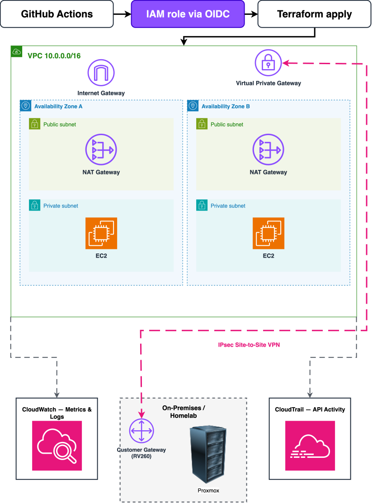

# Enterprise Hybrid AWS Environment 
 
 This is a project that I am building to gain a better understanding of cloud computing mixed with a on Site homelab. The goal of the Project is to mimic enterprise infrastructure patterns. The project is supplied entirely as Code, deployed through secure CI/CD pipeline,monitored end to end and connected to the homelab. 

## What this demonstrates 

The goal of this project is to replace manual,click-ops cloud set up with the kind of workflow that you would see a team actually run :

Infrastructure as Code -  a multi AZ AWS VPC and core networking, equiped with Terraform instead of the console, so the entire environment can be reproduced by running one command. 

Secure CI/CD - deployments run through GitHub Actions using OIDC federation so there are no long lived AWS access keys stored anywhere. 

Monitoring & observability - CloudWatch and CloudTrail wired in from day one for visibility into infrastructure health and account activity. 

Hybrid Networking - the AWS VPC is linked to a real on premises homelab running Proxmox over a site to Site connection so this project expands beyond just a Cloud only sandbox. 

## Architecture 



Multi-AZ VPC Provisioned via Terraform,deployed through GitHub actions Using OIDC, monitored with CloudWatch/CloudTrail and linked to on prem homelab over a site to site VPN.
 

## Tech Stack 
| Layer | Tool |
|:-------|--------:|
|IAC   |Terraform (1.10+,native S3 state locking)|
|Cloud provider| AWS |
|CI/CD | GitHub Actions(OIDC auth)|
|Monitoring| CloudWatch,CloudTrail|
|Hybrid link| AWS Site to Site VPN <-> Proxmox Homelab|

## Repository Structure
```
.
├── .github/
│   └── workflows/
│       └── terraform.yml      # plan on PR, apply on merge to main (environments/dev, modules/network)
├── docs/
│   ├── hybridhomelab.drawio.svg   # architecture diagram
│   └── tagging.md                 # cost-allocation tagging standard
├── environments/
│   ├── bootstrap/             # OIDC provider + IAM role for GitHub Actions, applied manually once
│   └── dev/                   # dev environment: network module + S3 remote state backend
│       └── waste-lab.tf       # placeholder, not wired up yet
├── modules/
│   ├── network/               # VPC, 2 public + 2 private subnets, IGW, NAT, route tables
│   ├── cicd-oidc/             # GitHub OIDC provider + IAM role (state access, VPC permissions)
│   └── waste-lab/             # scaffold only
├── LICENSE
└── README.md
```

## Setup 
Deployment Automation is completed. When a PR is opened touching `environments/dev/` or `modules/network/`-> GitHub Actions runs `terraform plan` automatically via OIDC so changes can be reviewed. Once the PR is merged to `main`, GitHub Actions runs `terraform apply` automatically which means nobody has to run terraform by hand and no long lived AWS credentials are required in the process. 
## Design Decisions 
Each entry: what I chose, why, and what it costs me.

1. Terraform state in S3 with native locking

Decision: Remote state in an encrypted S3 bucket, locked with use_lockfile = true (Terraform 1.10+). Why: It avoids the DynamoDB lock table that older setups needed, so there is one less resource to build, pay for and secure. Trade-off: Requires Terraform 1.10 or newer. The state bucket itself is not managed by this repo's Terraform.

2. GitHub Actions authenticates with OIDC, not access keys

Decision: The pipeline assumes an IAM role through OIDC federation. No AWS keys are stored in GitHub. Why: Credentials are short-lived, so there is nothing to rotate or leak. Scope: The role is trusted only for this repository. Its permissions are state-bucket access plus AmazonVPCFullAccess, and they grow only as modules need them. Known limitation: The trust condition matches any branch or event in the repo. Planned hardening: restrict it to main and pull requests.

3. Plan on every pull request, apply only on merge

Decision: A PR touching environments/dev/ or modules/network/ runs terraform plan. A merge to main runs terraform apply. Why: Every change is reviewed before it lands, and nobody runs Terraform by hand against shared infrastructure. Note: Manual workflow runs only plan. Applying happens through a merge or locally.

4. Bootstrap is separate from the environment

Decision: The OIDC provider and role live in environments/bootstrap/ and were applied manually once. Why: The pipeline cannot create the role it needs in order to run. Keeping this apart also means the pipeline cannot change its own access.

5. One NAT gateway in dev

Decision: Dev shares a single NAT gateway across both AZs (single_nat_gateway = true, the module default). Why: NAT gateways bill by the hour whether or not traffic flows, so one shared gateway cuts the idle cost. Trade-off: Private subnets in the second AZ depend on a gateway in the first, which is a single point of failure. A production environment would set this to false.

6. No IAM Identity Center

Decision: I do not use the root account for daily work. I use a separate IAM identity with roles scoped to this project. Why: Enabling IAM Identity Center would void the credits on my AWS account. Trade-off: In a real multi-account organization I would use Identity Center with permission sets and short-lived credentials.

7. The dev environment is created on demand

Decision: Dev is destroyed when not in use (terraform destroy in environments/dev/) and recreated when needed. Why: It keeps spend inside my credits. Trade-off: There is no always-on infrastructure to click through. The code, plan output and diagram are the evidence.

8. A tagging standard for cost attribution

Decision: Resources follow docs/tagging.md. Project, Environment, Owner and ManagedBy come from provider default_tags. Why: It lets cost data be broken down per component, such as the dev NAT gateway, and it feeds a planned cost-optimizer project. Status: The module-level Purpose and ExpiresOn tags are not applied yet.

Open decision: how the VPN terminates

(Fill this in once the choice is made.) Options: strongSwan VM on Proxmox, the RV260's native IPsec, or a Tailscale subnet router on EC2. The home network sits behind a double NAT, which affects all IPsec options.
## Roadmap
- [x] Repo scaffolded with module structure
- [x] AWS account Hygiene - MFA,billing alerts,CloudTrail 
- [x] Terraform Remote state backend (S3 native locking)
- [x] Multi-AZ VPC module 
- [x] GitHub Actions OIDC Pipeline (Plan on PR,apply on merge)
- [x] Tagging standard documented (docs/tagging.md)
- [ ] Apply the Purpose tag at module level
- [ ] Site to Site VPN link to homelab 
- [ ] CloudWatch dashboard + alarms
- [ ] waste-lab module (scaffold only so far)
## Status 
In Progress. This README will be updated as I complete the project.
## License 
MIT


