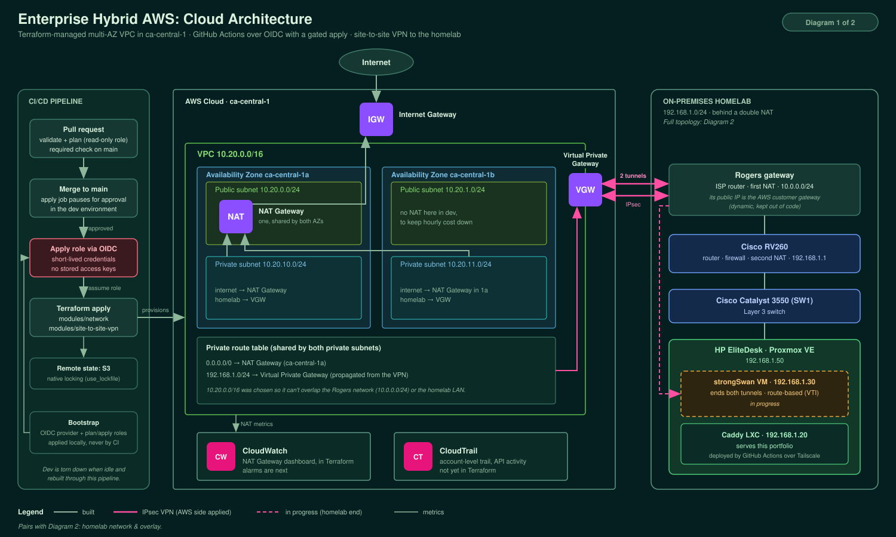
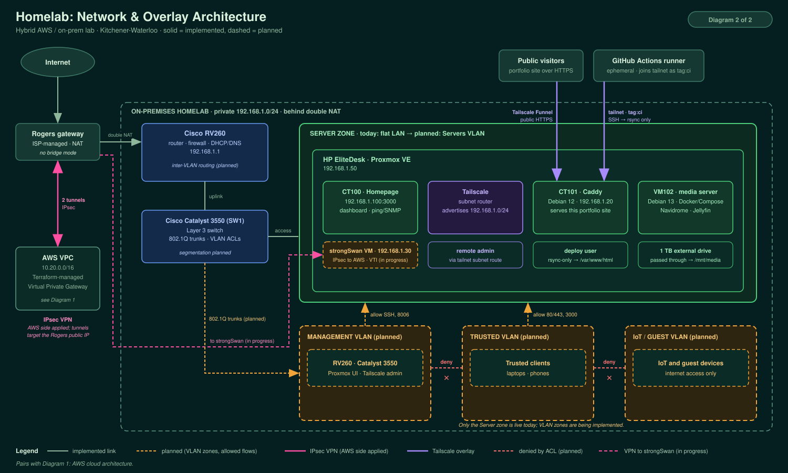

# Enterprise Hybrid AWS Environment

I'm building this project to understand how cloud infrastructure works alongside an on-site homelab. The goal is to copy the patterns real infrastructure teams use: everything is defined as code, deployed through a secured CI/CD pipeline with review and approval gates, and connected to a Proxmox homelab over a site-to-site VPN.

## What this demonstrates

The aim is to replace manual, click-ops cloud setup with the kind of workflow a team would actually run:

- **Infrastructure as Code**: a multi-AZ AWS VPC, core networking and a site-to-site VPN, all built with Terraform instead of the console, so the environment can be torn down and rebuilt from the repo.
- **Secure CI/CD**: GitHub Actions authenticates to AWS with OIDC federation, so no long-lived AWS access keys are stored anywhere. Planning and applying use separate IAM roles, and every apply waits for a human to approve it.
- **Monitoring & observability**: a CloudWatch dashboard for the NAT gateway is built in code. CloudTrail is enabled at the account level (codifying it in Terraform is on the roadmap), and CloudWatch alarms are next.
- **Hybrid networking**: the AWS VPC connects to a real on-premises Proxmox homelab over an IPsec site-to-site VPN, so this is more than a cloud-only sandbox. The AWS side is built; the homelab endpoint is in progress.

## Architecture





A multi-AZ VPC (`10.20.0.0/16`) in `ca-central-1` is provisioned with Terraform and deployed through GitHub Actions using OIDC. A Virtual Private Gateway provides two IPsec tunnels for a strongSwan VM in the homelab (`192.168.1.0/24`), which sits behind a double NAT. The strongSwan side is still being configured, so it's drawn dashed.

The diagrams are maintained in my portfolio repo and copied here.

## Tech Stack

| Layer | Tool |
|:------|:-----|
| IaC | Terraform (1.10+, native S3 state locking) |
| Cloud provider | AWS (`ca-central-1`) |
| CI/CD | GitHub Actions (OIDC auth, environment approval gate) |
| Monitoring | CloudWatch (dashboard), CloudTrail (account-level) |
| Hybrid link | AWS Site-to-Site VPN (VGW) <-> strongSwan on Proxmox |

## Repository Structure

```
.
├── .github/
│   └── workflows/
│       └── terraform.yml          # plan on every PR (required check); gated apply on merge to main
├── docs/
│   ├── hybridhomelab.svg          # cloud architecture diagram
│   ├── homelab-network.svg        # homelab network diagram
│   └── tagging.md                 # cost-allocation tagging standard
├── environments/
│   ├── bootstrap/                 # OIDC provider + plan/apply IAM roles, applied locally only
│   └── dev/                       # network + site-to-site VPN modules, S3 remote state
│       └── waste-lab.tf           # placeholder, not wired up yet
├── modules/
│   ├── network/                   # VPC, 2 public + 2 private subnets, IGW, NAT, route tables, NAT dashboard
│   ├── site-to-site-vpn/          # VGW, customer gateway, static-route IPsec VPN, route propagation
│   ├── github-oidc-role/          # reusable GitHub OIDC IAM role (exact subjects, scoped policies)
│   ├── cicd-oidc/                 # legacy wildcard role, unused, scheduled for removal
│   └── waste-lab/                 # scaffold only
├── LICENSE
└── README.md
```

## How deployment works

1. **Pull request**: every PR runs `terraform validate` and `terraform plan` against dev through a **read-only plan role**. The plan is a required status check, so nothing merges until it passes.
2. **Merge to `main`**: when the merge changes `environments/dev/` or a module dev uses, the apply job starts and **pauses for approval** in the `dev` GitHub environment. Docs-only and CI-only merges don't deploy.
3. **Approval**: once approved, the job assumes a separate **apply role**, plans again, and applies that saved plan.

The homelab's public IP is supplied from a GitHub Actions secret and marked `sensitive` in Terraform, so it never appears in code or in the public Actions logs.

### Running locally

```bash
export TF_VAR_homelab_public_ip=<your public IP>
terraform -chdir=environments/dev init
terraform -chdir=environments/dev plan
```

Local runs need Terraform 1.10+ and AWS credentials with access to the state bucket. Changes to shared infrastructure go through a pull request, not a local apply.

## Design Decisions

Each entry covers what I chose, why, and what it costs me.

**1. Terraform state in S3 with native locking**

Decision: Remote state in an encrypted S3 bucket, locked with `use_lockfile = true` (Terraform 1.10+).
Why: It avoids the DynamoDB lock table that older setups needed, so there's one less resource to build, pay for and secure.
Trade-off: Requires Terraform 1.10 or newer. The state bucket itself is created outside this repo's Terraform.

**2. GitHub Actions authenticates with OIDC, not access keys**

Decision: The pipeline assumes IAM roles through OIDC federation. No AWS keys are stored in GitHub.
Why: Credentials are short-lived, so there's nothing to rotate or leak.
Scope: There are two roles. The **plan role** is trusted only for `pull_request` runs and is read-only, apart from the dev state lock. The **apply role** is trusted only for jobs running in the `dev` GitHub environment, which requires approval and only deploys from `main`. Neither role can read the bootstrap state.
Remaining hardening: `AmazonVPCFullAccess` and `ReadOnlyAccess` are broad AWS-managed policies, and I plan to narrow them.

**3. Plan on every pull request, gated apply on merge**

Decision: Every PR runs `terraform plan` as a required check. A merge to `main` that changes dev runs the apply job, gated by an approval in the `dev` environment.
Why: Every change is reviewed, and nothing reaches AWS without a human approving it.
Note: A manual workflow run on `main` triggers the gated apply, not a plan.
Known gap: The apply job plans again after approval, so the approver doesn't see the exact plan that gets applied. The fix on the roadmap is to plan on `main` and hand that plan to the gated apply job as an artifact.

**4. Bootstrap is separate from the environment**

Decision: The OIDC provider and the plan/apply roles live in `environments/bootstrap/` and are applied locally, never by CI.
Why: The pipeline can't create the roles it needs in order to run. Keeping bootstrap separate also means the pipeline can't change its own access.

**5. One NAT gateway in dev**

Decision: Dev shares a single NAT gateway across both AZs (`single_nat_gateway = true`, the module default).
Why: NAT gateways bill by the hour whether or not traffic flows, so one shared gateway cuts the idle cost.
Trade-off: Private subnets in the second AZ depend on a gateway in the first, which is a single point of failure. A production environment would set this to `false`.

**6. No IAM Identity Center**

Decision: I don't use the root account for daily work. I use a separate IAM identity, with roles scoped to this project.
Why: Enabling IAM Identity Center would void the credits on my AWS account.
Trade-off: In a real multi-account organization I would use Identity Center with permission sets and short-lived credentials.

**7. The dev environment is created on demand**

Decision: Dev is destroyed when not in use and rebuilt through the pipeline when needed.
Why: It keeps spend inside my credits. The NAT gateway and VPN connection together cost about USD 2.40/day while running.
Trade-off: There's no always-on infrastructure to click through. The code, plan output and diagrams are the evidence.

**8. A tagging standard for cost attribution**

Decision: Resources follow [docs/tagging.md](docs/tagging.md). `Project`, `Environment`, `Owner` and `ManagedBy` come from provider `default_tags`.
Why: It lets cost data be broken down per component, such as the dev NAT gateway, and it feeds [CloudGuard](https://github.com/Mannixgr/CloudGuard), my AWS cost and security scanner, which groups its findings by these tags.
Status: The module-level `Purpose` and `ExpiresOn` tags aren't applied yet.

**9. The VPC moved to 10.20.0.0/16**

Decision: Dev uses `10.20.0.0/16`, set in `environments/dev`. The module defaults are unchanged.
Why: The original `10.0.0.0/16` overlapped the ISP gateway's network (`10.0.0.0/24`) on the homelab side, which would have broken routing over the VPN.
Trade-off: Changing a VPC's CIDR replaces the VPC, so I made the change before the VPN existed.

**10. The VPN terminates on a strongSwan VM**

Decision: An AWS Virtual Private Gateway with a static-route IPsec connection to a strongSwan VM on Proxmox (route-based, using VTI interfaces).
Why: The home network sits behind a double NAT (ISP gateway, then a Cisco RV260), and strongSwan handles NAT traversal and route-based tunnels well. Static routing means I don't have to run BGP on the VM. The tunnel inside CIDRs are pinned, so the VM config is known before the tunnels exist.
Trade-offs: The home public IP is dynamic. If it changes, the customer gateway and VPN connection are replaced, which brings new tunnel endpoints and keys. The VM is a single point of failure on the homelab side. The VPN connection costs about USD 0.05/hour, so it's destroyed with the rest of dev when not in use.

## Roadmap

- [x] Repo scaffolded with module structure
- [x] AWS account hygiene: MFA, billing alerts, CloudTrail
- [x] Terraform remote state backend (S3 native locking)
- [x] Multi-AZ VPC module
- [x] GitHub Actions OIDC pipeline (plan on PR, apply on merge)
- [x] Separate plan/apply IAM roles + environment approval gate
- [x] Tagging standard documented ([docs/tagging.md](docs/tagging.md))
- [x] CloudWatch dashboard for the NAT gateway
- [ ] Site-to-Site VPN: AWS side built; strongSwan configuration in progress
- [ ] CloudWatch alarms + billing alarm for VPN/NAT
- [ ] CloudTrail codified in Terraform
- [ ] Plan on `main` and apply that reviewed plan as an artifact (no re-plan after approval)
- [ ] CI quality gates: `terraform fmt -check`, tflint, security scanning, actions pinned by commit SHA
- [ ] Narrow managed IAM policies to least privilege
- [ ] Retire the legacy `cicd-oidc` role
- [ ] Apply the `Purpose` and `ExpiresOn` tags at module level
- [ ] waste-lab module (scaffold only so far)

## Status

In progress (last updated October 2026). I'll update this README as I complete each part of the project.

## License

MIT
